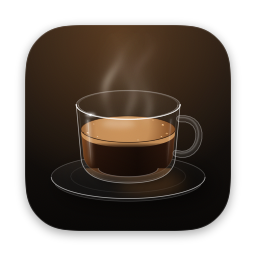
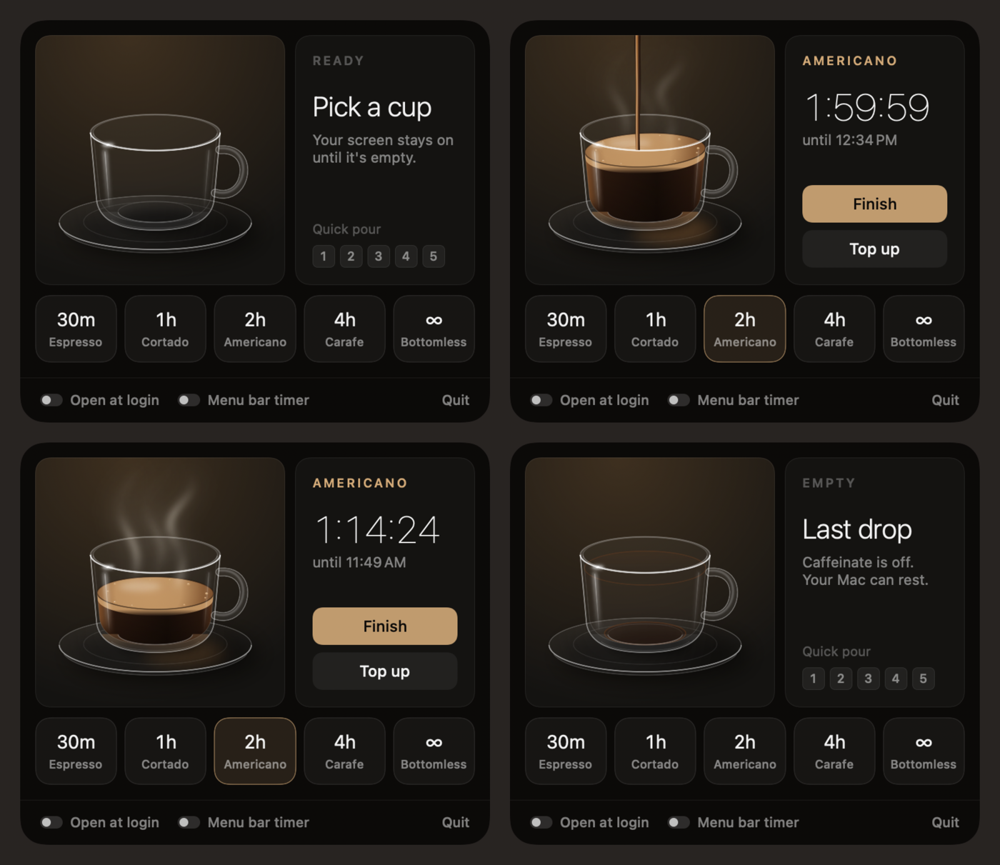

<p align="center"></p>

<h1 align="center">Pour</h1>

<p align="center">A glass cup of coffee in your menu bar that keeps your Mac awake.</p>

<p align="center"></p>

Pick a drink and it pours. While it steams, your screen stays on and your Mac stays awake. The cup drains as the time runs out, and when it's empty your Mac is free to sleep again.

## Install

Paste this into Terminal:

```bash
curl -fsSL https://raw.githubusercontent.com/zeelatLayer3/pour/main/install.sh | bash
```

It downloads the latest release into Applications and opens it. Look for the cup near the clock in your menu bar.

Needs macOS 14 Sonoma or later, on Apple Silicon or Intel.

<details>
<summary>Install by hand instead</summary>

1. Download `Pour.zip` from the [latest release](https://github.com/zeelatLayer3/pour/releases/latest) and unzip it.
2. Drag `Pour.app` into Applications.
3. Pour isn't notarized by Apple yet, so macOS blocks the first launch. Open System Settings → Privacy & Security, scroll down, and click **Open Anyway** next to Pour. You only do this once.

</details>

## Use

Click the cup in the menu bar.

| Drink | Awake for |
| --- | --- |
| Espresso | 30 minutes |
| Cortado | 1 hour |
| Americano | 2 hours |
| Carafe | 4 hours |
| Bottomless | Until you press Finish |

- **Finish** drains the cup and lets your Mac sleep right away. **Top up** refills it to full.
- Keys inside the panel: `1` to `5` pour, `Return` finishes, `Esc` closes, `⌘Q` quits.
- Pour opens at login by default. Turn that off in the panel's footer.
- **Menu bar timer** shows the time left next to the cup.
- Hold `⌘` and drag the cup to move it in the menu bar.

## How it keeps your Mac awake

Pour runs Apple's built-in `caffeinate -d -i -m -s -w <pour pid>`, which blocks display, idle, disk, and system sleep. `-w` ties caffeinate to Pour, so quitting or crashing Pour can never leave a stray keep-awake behind. Timed cups also pass `-t <seconds>`, so they expire on time even if macOS pauses Pour. System sleep is only blocked on power; on battery, macOS still prevents idle sleep but always sleeps when you close the lid.

The panel only animates while it's open. The menu bar cup animates briefly when pouring or draining, then stays still, so Pour costs almost nothing in the background.

## Uninstall

Turn off **Open at login** in the panel, click **Quit**, then delete `Pour.app` from Applications.

## Build from source

Needs Xcode 16 or later.

```bash
git clone https://github.com/zeelatLayer3/pour.git && cd pour
./scripts/build.sh            # builds build/Pour.app (universal, ad-hoc signed)
./scripts/build.sh --install  # also copies it to /Applications and opens it
```

Check it:

```bash
.build/debug/Pour --selftest          # scheduling, real expiry, top up, recovery, Finish, and shutdown
.build/debug/Pour --snapshot <dir>    # renders every panel state to PNG
```
